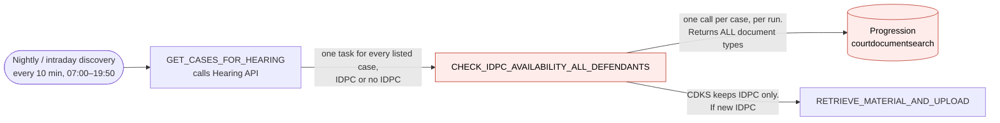
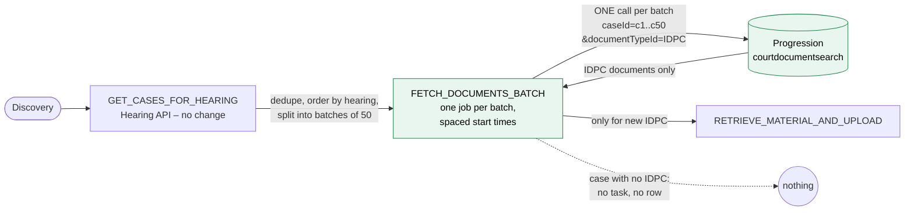
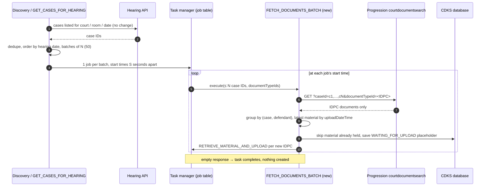
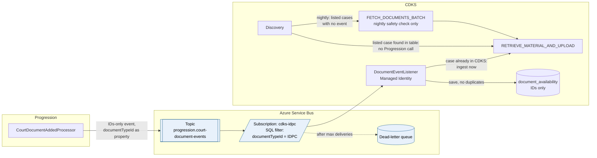

# TA Forum Paper: Create IDPC ingestion tasks only when an IDPC is available

| Item | Detail |
|---|---|
| Service | `cp-case-document-knowledge-service` (CDKS) |
| Jira | [DD-43926](https://hmcts.atlassian.net/browse/DD-43926) (spike — investigation & recommendation; implementation stories are raised as separate tickets) |
| Pipeline stage | Stage 2 – Architecture and Design (draft v2, not yet approved) |
| Version | **v2 – 11-Nov-2026**, updated after the architecture review (v1: 05-Nov-2026) |
| Related documents | [`00-input-brief.md`](./00-input-brief.md), [`03-stories.md`](./03-stories.md) (will be updated after the forum), [ADRs](../adrs/DD-43926-idpc-gated-ingestion-dispatch.md) |

> [!IMPORTANT]
> **In one line:** Progression gets a new generic filter, so it returns **only IDPC documents**.
> CDKS asks for 50 cases in one call and creates an ingestion task **only when an IDPC comes back**.
> Later, Progression sends IDPC events on **Azure Service Bus**, so CDKS needs no call at all for
> most new IDPCs.

> [!NOTE]
> **Delivery scope (12-Nov-2026).** Only **Part 1** is planned for delivery now. **Part 2 is deferred**:
> no implementation ticket is raised for it yet, and Section 8 stays as the target design for later.
> Before any Progression change is requested, an **analysis ticket** checks whether Progression's
> existing `sectionId` filter can be used instead of a new `documentTypeId` parameter (Section 6.0).
> Tickets: parent [DD-43976](https://hmcts.atlassian.net/browse/DD-43976); analysis [DD-43977](https://hmcts.atlassian.net/browse/DD-43977); batch fetch [DD-43978](https://hmcts.atlassian.net/browse/DD-43978). Details in [`03-stories.md`](./03-stories.md).

---

## 1. Summary

At present, CDKS creates one check task for every case on the hearing list. Each task calls
Progression, gets **every document** of the case, and keeps only the IDPC. Most of this work is
repeated, and much of it finds nothing.

We propose to change this in two parts.

| | Part 1 – Filtered batch fetch (build first) | Part 2 – Events on Azure Service Bus (target) |
|---|---|---|
| **What changes** | Progression adds an optional, generic **`documentTypeId`** filter to its existing `courtdocumentsearch` query. CDKS sends 50 case IDs plus the IDPC type ID in one call, and gets back **only IDPC documents**. | Progression publishes a document event on **Azure Service Bus**. CDKS subscribes with Managed Identity, for the IDPC type only. |
| **Tasks created** | One fetch task per batch of 50 cases. RETRIEVE tasks **only for a new IDPC**. The per-case check task is removed. | RETRIEVE task straight from the event. No fetch task for that case. |
| **Calls to Progression for 5,000 listed cases** | 100, at a planned rate | Zero for cases with an event. A nightly safety check only. |
| **Needs** | Progression: a small, backwards-compatible query change | Progression and Platform: the Service Bus topic, as part of the event upgrade they are already doing |

**No second check.** Progression filters by type, so the response **is** the answer. CDKS does not
ask Progression again for each case, and does not create any task for a case without an IDPC.

## 2. Decisions requested from the forum

| No. | Decision | Section |
|---|---|---|
| D1 | Approve **an analysis first** on how Progression filters by type: the existing `sectionId` filter (as is, or with a small change) or a new optional, generic `documentTypeId` filter on `courtdocumentsearch`. The Progression change is requested **only after** this analysis. | 6.0, 6 |
| D2 | Approve **Part 1**: replace the per-case check task with **one fetch task per batch of case IDs**. The task makes one filtered call and creates RETRIEVE tasks directly from the response. | 7 |
| D3 | Note **Part 2** as the target design: CDKS to consume Progression document events from **Azure Service Bus** (topic subscription filtered on `documentTypeId`, Managed Identity). **Deferred – not for approval or delivery now.** | 8 |
| D4 | Note the CDKS table `document_availability` for Part 2. **Deferred with Part 2.** | 8.4 |
| D5 | Agree the Part 1 asks to other teams (Section 10), with owners. | 10 |

### What changed after the architecture review (v1 → v2)

| Topic | v1 (05-Nov) | v2 (this paper) |
|---|---|---|
| Type filter | CDKS filtered IDPC out of the full response. The Progression filter was optional. | **Progression filters by type**, through a new generic `documentTypeId` parameter. It is a **required** part of Part 1. |
| Task after the call | A "check" task per batch, which then re-checked the type | A **fetch** task per batch. The response holds only IDPCs, so RETRIEVE tasks are created straight from it. |
| Event route | Open choice: Artemis bridge or a direct Artemis subscription | **Azure Service Bus**, in line with the platform upgrade of events |
| Event payload | IDs only, so one more Progression call was needed for details | Event carries everything RETRIEVE needs, so **no Progression call** is made for an event |
| Table | `idpc_availability` | `document_availability`, with a `document_type_id` column, so it is generic too |

---

## 3. Background – how it works today



### Problems with the present design

| No. | Problem | Where in code |
|---|---|---|
| P1 | A check task is created for every listed case, even when the case has no IDPC. Many of these tasks do nothing. The exact number is not yet measured (see Section 12). | `GetCasesForHearingTask`, `DiscoveryService.dispatchCaseEligibilityCheck` |
| P2 | The same cases are checked again and again. For a requested court room, intraday discovery runs up to 78 times on the hearing day, and every run calls Progression once per case. | `IntradayDiscoveryScheduler`, `ProgressionClientImpl.getCourtDocumentsForAllDefendants` |
| P3 | Progression returns **every document** of the case (statements, exhibits, notices…). It transforms each one, checks its permissions and sends it to CDKS, and CDKS then throws away everything except the IDPC. | `CourtDocumentQueryView.searchCourtDocuments`, `ProgressionDtoMapper.mapToLatestMaterialInfo:38-42` |
| P4 | An IDPC added after the last run (19:50), or for a case not yet listed, is picked up only at a later run. | Scheduler cron, `scheduled_ingestion_request` |
| P5 | Job rows, retries (3 × 20 s) and logs grow with the number of listed cases, not with the number of IDPCs. This makes support harder. | `CheckIdpcAvailabilityAllDefendantsTask` |
| P6 | The flow is not easy to follow. The service owner has asked: *"task only created when IDPC there, to make things simple."* | `00-input-brief.md` |

## 4. Goals

1. Create an ingestion task only when there is a new IDPC to ingest.
2. Ask Progression only for what CDKS needs: IDPC documents, many cases per call, and no repeat check.
3. Pick up a new IDPC quickly.
4. Do not miss any IDPC, and do not ingest the same material twice.
5. Keep data protection as it is: IDs only in tables, messages and logs, apart from the material file label CDKS already stores today.
6. Keep each change behind a toggle, so it is safe to roll out and roll back.
7. Build the Progression change **generic**, so other services can filter by any document type.

---

## 5. What Progression provides today

We checked the Progression code (`hmcts/cpp-context-progression`, branch `main`, commit `ceebd3c`,
23-Oct-2026).

| Capability | Details | Use in this design |
|---|---|---|
| **Batch query: `GET /courtdocumentsearch?caseId=id1,id2,id3`** | The RAML says `caseId` is "comma separated". The view splits the list and reads all documents for all the cases with **one database query** (`findByProsecutionCaseIds(List)`). The media type is `application/vnd.progression.query.courtdocuments+json`, the **same endpoint and media type CDKS calls today** with one case ID. | **Part 1**, with the new type filter (Section 6) |
| **Type filter in SQL (paginated search only)** | The paginated search (`courtdocuments.with.pagination`) already filters on the document type, in SQL, through its `sectionId` parameter: `jsonb_extract_path_text(payload, 'documentTypeId')`. It takes only one case ID and returns PDF summaries only. | **The pattern** for the new filter (Section 6). Not called directly. |
| **Event: `public.progression.idpc-document-received`** | Raised by `CourtDocumentAddedProcessor` when an IDPC (`41be14e8-9df5-4b08-80b0-1e670bc80a5b`) is added. One event per defendant per material. Payload: `caseId`, `defendantId`, `materialId`, `publishedDate`. Published today on the CPP Artemis public topic. | **The source** for the Part 2 Service Bus event (Section 8) |
| Event `public.progression.court-document-added` | A general event for all documents. Its payload has the case URN and defendant names. | Not used, because it contains personal data |

### 5.1 Batch query – verified in Progression code

**How long it has existed.** `git blame` shows that every line quoted below comes from commit
`27b2bf2a`, "Initial commit of migrated source code", dated 17-Dec-2025, when Progression moved to
GitHub. So the feature is **older than 17-Dec-2025**. Two later commits changed
`CourtDocumentQueryView.java` (`982819b0`, 19-Mar-2026; `f58c1ea2`, 03-Sep-2026), but neither touched
these lines. It is a long-standing, stable part of the API.

#### 5.1.1 Call path, step by step

**Step 1 – RAML contract: the endpoint accepts a list of case IDs.**
File: `progression-query/progression-query-api/src/raml/progression-query-api.raml`
(shortened; unrelated media types and parameters removed)

```yaml
# line 3
baseUri: http://localhost:8080/progression-query-api/query/api/rest/progression
...
# line 342
/courtdocumentsearch:
  get:
      description: |
        ...
        (mapping):
            responseType: application/vnd.progression.query.courtdocuments+json   # line 348
            name: progression.query.courtdocuments                                # line 349
        ...
      queryParameters:
              caseId:                                                             # line 367
                description: caseId(s) - comma separated to be searched           # line 368
                type: string
                example: b44fa9bb-dc36-4375-83a9-ff1bc4cd4374,1f1fba3c-34ee-454e-b3be-5fb845b2de4a
                required: false
              ...
              sectionId:                                                          # line 392
                description: sectionId of the material
                type: string
                required: false
              ...
      responses:
            200:
                body:
                  application/vnd.progression.query.courtdocuments+json:           # line 428
                    example:  !include json/progression.query.courtdocuments.json
                    schema:  !include json/schema/progression.query.courtdocuments.json
```

The `baseUri` plus `/courtdocumentsearch` is the same path that CDKS calls today
(`application-clients.yml`: `court-docs-path`).

**Step 2 – Access control: the CDKS system user is allowed.**
File: `progression-query/progression-query-api/src/main/resources/uk/gov/moj/cpp/progression/query/api/accesscontrol/query-access-control.drl`, lines 32–40

```drools
rule "Query - Access control for  progression.query.courtdocuments"
  when
    $outcome: Outcome();
    $action: Action(name == "progression.query.courtdocuments");
    eval(userAndGroupProvider.isMemberOfAnyOfTheSuppliedGroups($action, "System Users","Court Clerks", ... ))
  then
    $outcome.setSuccess(true);
end
```

**Step 3 – Query API: the request is passed to the view unchanged.**
File: `progression-query/progression-query-api/src/main/java/uk/gov/moj/cpp/progression/query/api/CourtDocumentQueryApi.java`, lines 129–139

```java
@Handles(COURT_DOCUMENTS_SEARCH_NAME)          // "progression.query.courtdocuments" (line 65)
public JsonEnvelope searchCourtDocuments(final JsonEnvelope query) {
    final Optional<UserGroupsDetails> magsGroup = getMagistratesGroup(query);
    final Optional<HearingDetails> hearingDetails = getHearingDetails(query);

    if (magsGroup.isPresent() && hearingDetails.isPresent() && isSharedCourtDocumentsQuery(query, hearingDetails.get())) {
        return requestSharedCourtDocuments(query, magsGroup.get().getGroupId().toString());
    }
    return courtDocumentQueryView.searchCourtDocuments(query);
}
```

The special branch applies only to a Magistrates user **and** a `hearingId` parameter
(`getHearingDetails`, lines 289–293). CDKS sends neither, so the request always goes to the view.

**Step 4 – Query view: the list is split and searched in one go.**
File: `progression-query/progression-query-view/src/main/java/uk/gov/moj/cpp/progression/query/CourtDocumentQueryView.java`

```java
// lines 219-223 – how the caseId parameter is parsed
private List<UUID> commaSeparatedUuidParam2UUIDs(final String strUuids) {
    return Stream.of(strUuids.split(","))
            .map(UUID::fromString)
            .collect(Collectors.toList());
}

// lines 300-303 – branch taken when only caseId is sent (no defendantId)
} else if (isNotEmpty(strCaseIds)) {
    foundSearchParameter = true;
    final List<CourtDocumentEntity> byProsecutionCaseIds = courtDocumentRepository
            .findByProsecutionCaseIds(commaSeparatedUuidParam2UUIDs(strCaseIds));
```

After the read, the same view applies these steps to **every document read**:

| Line | Code | Effect |
|---|---|---|
| 227 | `getUserGroupsByUserId(envelope)` | One user-groups lookup **per request**, not per case |
| 335 | `getAllDocumentTypeAccess()` | One reference-data lookup **per request**, not per case |
| 338 | `.filter(entity -> !entity.isRemoved())` | Removed documents are excluded |
| 340 | `.map(this::courtDocument)` | JSON parse of each document, plus one database lookup per document (`CourtDocumentTransform.java:40`) |
| 341 | `isAllowedToAccessDocumentForGivenAction(...)` | Document-type permission for the caller |
| 343 | `id2CourtDocument.put(courtDocument.getCourtDocumentId(), ...)` | Each court document is returned **once**, even if it matches more than one case |
| 353, 362 | `getPermittedGroups(...)`, `filterPermittedMaterial(...)` | Material-level user-group permission |
| 369 | `sorted(Comparator.comparing(CourtDocument::getSeqNum))` | Stable order |

The per-document cost (lines 338–369) is paid for **every** document type today. The new filter
(Section 6) removes non-IDPC documents **before** this step.

**Step 5 – Repository: one SQL query for all cases in the batch.**
File: `progression-viewstore/progression-viewstore-persistence/src/main/java/uk/gov/moj/cpp/prosecutioncase/persistence/repository/CourtDocumentRepository.java`, lines 36–38

```java
@Query("FROM CourtDocumentEntity cde join fetch cde.indices cdi where cdi.prosecutionCaseId in (:caseIds) ORDER BY cde.seqNum ASC")
List<CourtDocumentEntity> findByProsecutionCaseIds(
                @QueryParam("caseIds") final List<UUID> caseIds);
```

**Step 6 – Response: each IDPC tells us its case and its defendants.**
IDPC is a defendant-level document. File: `progression-query/progression-query-view/src/main/java/uk/gov/moj/cpp/progression/query/CourtDocumentTransform.java`, lines 62–64

```java
private void map(final DefendantDocument document, CourtDocumentIndex.Builder index) {
    index.withCaseIds(Arrays.asList(document.getProsecutionCaseId()));
    index.withDefendantIds(document.getDefendants());
```

So in a batch response, every IDPC `documentIndices[]` item has exactly **one** `caseId` and its list
of `defendantIds`. CDKS can group the results by case and defendant without ambiguity.

**Step 7 – Progression's own unit test already uses a comma-joined list.**
File: `progression-query/progression-query-view/src/test/java/uk/gov/moj/cpp/progression/query/CourtDocumentQueryViewTest.java`

```java
// line 512
public void shouldFindDocumentsByCaseIdsAndApplicationIdPermitted() throws IOException {
    shouldFindDocuments(true, true, asList(UUID.randomUUID(), UUID.randomUUID()), null, ...);
}
// line 1092 (inside the helper) – how the request parameter is built
jsonBuilder.add(CASE_ID_SEARCH_PARAM, caseIds.stream().map(UUID::toString).collect(Collectors.joining(",")));
```

#### 5.1.2 Findings that affect the design

| No. | Finding | Evidence | Effect on the design |
|---|---|---|---|
| E1 | The list is split on `,` with **no trimming**. An ID with a space fails `UUID.fromString`, and the whole request fails. | `CourtDocumentQueryView.java:219-223` | CDKS joins IDs with `,` and no spaces. The new parameter is parsed with trimming (Section 6). |
| E2 | Do **not** send `defendantId` in the batch call. With it, a different branch runs (`findByProsecutionCaseIdAndDefendantId`), and the master-defendant lookup works only for one case (`caseIdList.size() == 1`). | `CourtDocumentQueryView.java:265-296` | CDKS sends `caseId` and `documentTypeId` only. |
| E3 | Today Progression does **not** filter by type in this query. The response holds every document type. | Steps 4–5 (no type predicate) | **Fixed by the new filter** (Section 6). |
| E4 | There is no limit on the number of IDs in Progression code. The practical limits are the URL length (APIM) and the response size. | `CourtDocumentQueryView.java:219-223`, `CourtDocumentRepository.java:36` | Batch size is configurable. With the filter, the response holds only IDPCs, so it stays small. |
| E5 | Permission lookups are made **once per request**, so batching also cuts Progression's own calls to user groups and reference data. | `CourtDocumentQueryView.java:227, 335` | Extra benefit, no action. |
| E6 | A document linked to more than one case in the batch is returned only once. | `CourtDocumentQueryView.java:343` | When grouping, CDKS links the document to each `caseId` in its list. For IDPC there is only one (Step 6). |
| E7 | The response schema lists `"required": ["documents"]`, but the property is `documentIndices`. CDKS uses this media type successfully today. | `progression-query-api/src/raml/json/schema/progression.query.courtdocuments.json` | Raise to Progression as a minor fix, in the same change. |
| E8 | `courtdocuments-all` (System Users only) also takes a list of case IDs, but **skips the user-group and material permission filtering**. | DRL lines 42–47, `CourtDocumentQueryView.java:469-490` | **Not used.** The new filter goes on the permission-checked `courtdocuments` mapping. |

#### 5.1.3 How an IDPC is identified

An IDPC is identified **only** by `document.documentTypeId == 41be14e8-9df5-4b08-80b0-1e670bc80a5b`.

| Source | What it shows |
|---|---|
| Progression reference-data fixture `progression-query-view/src/test/resources/get-all-document-type-access.json:2205-2210` | `"id": "41be14e8-…"`, `"section": "IDPC bundle"`, `"sectionCode": "IDPC"`, `"documentCategory": "Defendant level"` |
| Progression `CourtDocumentAddedProcessor.java:62` | `IDPC_DOCUMENT_TYPE_ID = fromString("41be14e8-9df5-4b08-80b0-1e670bc80a5b")` – the same ID raises `idpc-document-received` |
| CDKS `application-clients.yml:31` | `doc-type-id: "41be14e8-9df5-4b08-80b0-1e670bc80a5b"` |

The query filter, the event and CDKS all use **one and the same type ID**, so Part 1 and Part 2 agree
on what an IDPC is.

**The name is not reliable.** Progression's own integration test adds an IDPC with
`"name": "SJP Notice"` (`progression-integration-test/src/test/resources/progression.add-idpc-court-document.json:12-14`).
This is why the filter is on the type ID and never on the name.

---

## 6. Progression change – generic `documentTypeId` filter

### 6.0 Analysis first – can the existing `sectionId` filter be used?

Progression already filters by type in SQL, through `sectionId`, but only on the **paginated** media
type `application/vnd.progression.query.courtdocuments.with.pagination+json` (same `/courtdocumentsearch`
endpoint, different handler). Before asking for a new parameter, an analysis ticket confirms whether this
existing filter, as is or with a small change, meets CDKS's needs.

**Initial reading** (`hmcts/cpp-context-progression`, branch `main`, commit `f3dbf8c`, 07-Nov-2026). To be
confirmed by the analysis.

| CDKS need | `with.pagination` + `sectionId` today | Evidence |
|---|---|---|
| Type filter in SQL | Yes – `sectionId` is compared with `documentTypeId` (one value) | `CourtDocumentIndexCriteriaRepository.java:75-76` |
| CDKS system user allowed | Yes – "System Users" is in the rule | `query-access-control.drl:51-58` |
| Many cases per call | **No – one case only.** `caseId` is read with `getUUID`, so a comma list fails | `CourtDocumentQueryView.java:507` |
| Case and defendant per document | **No.** The summary has no `caseIds` or `defendantIds`; CDKS ingests per defendant | `CourtDocumentQueryView.java:597-613` (`getCourtDocumentSummary`) |
| Latest material by `uploadDateTime` | **Not guaranteed** – the first material only (`findFirst()`) | `CourtDocumentQueryView.java:546-547` |
| Every IDPC file type | **PDF only** – non-PDF documents are dropped | `CourtDocumentQueryView.java:522` |
| All results in one response | **Paged** – 20 per page by default, sorted by date | `CourtDocumentQueryView.java:148, 551-556` |
| Same permission checks as today | Yes – document-type and material checks | `CourtDocumentQueryView.java:523, 540-542` |

**Early view.** `sectionId` gives the type filter, but not batching, not the defendant, and not
reliably the latest material. Used as is, CDKS would need at least one call per case (perhaps per
defendant), which is close to today's call count. The analysis decides between:

| Option | Description |
|---|---|
| (a) | Use `with.pagination` + `sectionId` as is |
| (b) | A small change to `with.pagination` (for example, several `caseId` values, and `caseIds`/`defendantIds` plus all materials in the summary) |
| (c) | The new `documentTypeId` parameter on `courtdocuments+json` (Sections 6.1–6.7) |

Sections 6.1–6.7 describe option (c), the current proposal. They are kept as the reference until the
analysis concludes.

### 6.1 The change in one view

Add one **optional** query parameter to the existing `courtdocumentsearch` endpoint:

| Item | Value |
|---|---|
| Parameter name | **`documentTypeId`** |
| Value | One or more reference-data document type IDs, comma separated |
| Applies to | Media type `application/vnd.progression.query.courtdocuments+json` (the one CDKS uses) |
| When absent | **Behaviour exactly as today.** No existing caller is affected. |
| When present | Only documents whose `documentTypeId` is in the list are read, transformed and returned |
| Access control | **No change.** Same mapping, same DRL rule, same permission filtering |
| Response schema | **No change** |

### 6.2 Why this name

| Option | Verdict | Reason |
|---|---|---|
| **`documentTypeId`** (comma separated) | **Chosen** | It is the exact field name in the response (`document.documentTypeId`) and in reference data. It follows the convention of this endpoint, where `caseId` and `applicationId` are also singular names that take a comma-separated list. It is generic: any document type, any number of types. |
| `documentTypeIds` | Not chosen | Plural would break the naming convention of this endpoint. |
| `sectionId` | Not chosen | Already used by the paginated search for the same purpose, but "section" is a reference-data grouping label, not the field name, and it takes a single value. Reusing it here would be confusing. Progression may later align both names. |
| `idpcOnly=true` | Not chosen | Not generic. Every new document type would need a new parameter. |

### 6.3 Proposed RAML

```yaml
/courtdocumentsearch:
  get:
      queryParameters:
              caseId:
                description: caseId(s) - comma separated to be searched
                ...
              documentTypeId:                                                  # NEW
                description: |
                  Optional. Reference-data document type id(s), comma separated.
                  When present, only court documents of these types are returned.
                  When absent, all document types are returned (unchanged behaviour).
                type: string
                example: 41be14e8-9df5-4b08-80b0-1e670bc80a5b
                required: false
```

### 6.4 Proposed code (for the Progression team to finalise)

**Repository** – a new method beside `findByProsecutionCaseIds`. It uses the same JSON expression
Progression already uses for `sectionId` in `CourtDocumentIndexCriteriaRepository.java:75-77`.

```java
@Query("FROM CourtDocumentEntity cde join fetch cde.indices cdi "
     + "where cdi.prosecutionCaseId in (:caseIds) "
     + "and function('jsonb_extract_path_text', function('jsonb', cde.payload), 'documentTypeId') in (:documentTypeIds) "
     + "ORDER BY cde.seqNum ASC")
List<CourtDocumentEntity> findByProsecutionCaseIdsAndDocumentTypeIds(
        @QueryParam("caseIds") final List<UUID> caseIds,
        @QueryParam("documentTypeIds") final List<String> documentTypeIds);
```

**View** – read the parameter and pick the filtered method in the case-ID branch (lines 300–303).

```java
private static final String DOCUMENT_TYPE_ID_SEARCH_PARAM = "documentTypeId";

final List<String> documentTypeIds = getString(envelope.payloadAsJsonObject(), DOCUMENT_TYPE_ID_SEARCH_PARAM)
        .map(v -> Stream.of(v.split(",")).map(String::trim).filter(s -> !s.isEmpty())
                        .map(s -> UUID.fromString(s).toString())   // validates, returns 400 on bad input
                        .toList())
        .orElse(List.of());

} else if (isNotEmpty(strCaseIds)) {
    foundSearchParameter = true;
    final List<UUID> caseIds = commaSeparatedUuidParam2UUIDs(strCaseIds);
    courtDocumentEntities.addAll(documentTypeIds.isEmpty()
            ? courtDocumentRepository.findByProsecutionCaseIds(caseIds)
            : courtDocumentRepository.findByProsecutionCaseIdsAndDocumentTypeIds(caseIds, documentTypeIds));
}
```

For the other branches (`defendantId`, `applicationId`), the same list is applied as an in-memory
filter on the result, so the parameter means the same thing on every branch. Only the case-ID branch,
which is the one used at volume, needs the database filter.

### 6.5 Why it is safe

| Point | Detail |
|---|---|
| Backwards compatible | Optional parameter. Without it, the code path is the current one, line for line. |
| Same security | The permission filtering in Step 4 still runs on every document that is returned. The filter only **removes** documents; it can never add one. |
| Proven SQL | The JSON expression is already used in production by the paginated search. |
| Index | No new index is needed. Rows are first narrowed by case ID through the existing index table, and the type check runs only on that case's rows. |
| No change to the response | Same media type and same schema, so no consumer contract changes. |
| Tests | Unit tests in `CourtDocumentQueryViewTest` (with, without, several types, bad ID → 400), and one integration test that adds an IDPC and another document type to a case and checks that only the IDPC comes back. |

### 6.6 Gain

| For 5,000 listed cases (100 batches of 50) | Without filter | With `documentTypeId` filter |
|---|---|---|
| Documents read from the database | All documents of 5,000 cases | IDPC documents only |
| JSON parse + per-document lookup + permission checks (Step 4) | Every document | IDPC documents only |
| Response size | Every document type | IDPC documents only (small) |
| Type check in CDKS | Needed | **Not needed** – the response is the answer |

### 6.7 Example call from CDKS

Synthetic IDs. Path and headers as in `application-clients.yml` today.

```http
GET /progression-query-api/query/api/rest/progression/courtdocumentsearch?caseId=11111111-1111-4111-8111-111111111111,22222222-2222-4222-8222-222222222222&documentTypeId=41be14e8-9df5-4b08-80b0-1e670bc80a5b
Accept: application/vnd.progression.query.courtdocuments+json
CJSCPPUID: <system user id>
```

Response: only case `1111…` has an IDPC, so only one item comes back. Case `2222…` has no IDPC, so
nothing comes back for it, and CDKS creates nothing for it.

```json
{
  "documentIndices": [
    {
      "caseIds": ["11111111-1111-4111-8111-111111111111"],
      "defendantIds": ["33333333-3333-4333-8333-333333333333"],
      "document": {
        "courtDocumentId": "44444444-4444-4444-8444-444444444444",
        "documentTypeId": "41be14e8-9df5-4b08-80b0-1e670bc80a5b",
        "name": "IDPC",
        "materials": [
          { "id": "55555555-5555-4555-8555-555555555555", "uploadDateTime": "2026-11-04T09:15:00Z" }
        ]
      }
    }
  ]
}
```

---

## 7. Part 1 – Filtered batch fetch, run as job-manager tasks

### 7.1 Idea



- Discovery creates **one job-manager task per batch of 50 cases**, `FETCH_DOCUMENTS_BATCH`.
- Each task makes **one** filtered Progression call. The response contains **only IDPC documents**.
- The task creates `RETRIEVE_MATERIAL_AND_UPLOAD` tasks **straight from the response**, only for
  material CDKS does not already hold.
- **There is no check step any more.** The per-case `CHECK_IDPC_AVAILABILITY_ALL_DEFENDANTS` task is
  not created, and CDKS never asks Progression a second time for the same case in the same run.
- The task is **generic**: the type IDs are in its job data (`documentTypeIds`), taken from
  configuration. Today that is the IDPC type only.

**Why one task per batch, and not a loop inside one task:**

| Point | Loop inside one task | One task per batch (chosen) |
|---|---|---|
| Pod restart or deployment in the middle | The loop is lost, and the whole task runs again from batch 1 | Finished batches stay finished. Pending batches are still in the database. |
| One batch fails (timeout, 5xx, 429) | The whole task fails, and the retry repeats batches that already worked | Only that batch is retried |
| Control of the call rate | Must be coded by hand (sleep, rate limiter) | Comes from the planned start time of each task (Section 7.4) |
| Monitoring | One task, hard to see progress | Each batch is visible: pending, retrying, done |
| Fits the existing design | New pattern | Same job-manager pattern CDKS uses for every other step |

### 7.2 Flow



### 7.3 Steps in detail

1. **Get the listed cases.** Discovery gets the case list from the Hearing API, as today.
2. **Remove duplicates and order.** Each case ID is kept once. Cases are ordered by hearing date,
   nearest first (the hearing-proximity priority from DD-43823).
3. **Make batches** of size N, `cdk.ingestion.document-batch.size` (default 50).
   - 50 UUIDs make about 1,850 characters in the URL; with the type ID about 1,900.
   - IDs are joined with `,` and **no spaces** (E1).
   - The final N is agreed with APIM and tested in NFT (Section 10).
4. **Plan the start times.** Batch *i* starts at `runStart + i × S`, where
   `S = 60 / cdk.ingestion.document-batch.max-calls-per-minute`. For the nightly run, the batches can
   also be spread over the existing stagger window (DD-43823).
5. **Create one job per batch.**
   - Job data: `requestId`, `cppuid`, `caseIds` (≤ N), `documentTypeIds`, `batchNumber`,
     `batchCount` (about 2 KB). IDs only.
   - Priority: the priority of the nearest hearing in the batch.
6. **Run the batch task.** At its start time, the task:
   - calls `courtdocumentsearch?caseId=…&documentTypeId=…` **once**, on the existing APIM and Managed
     Identity chain;
   - **groups by (caseId, defendantId)** and takes the latest material by `uploadDateTime`. Today
     `getCourtDocumentsForAllDefendants` groups by `defendantId` only, because it is called for one
     case;
   - applies the existing local rules of `IdpcAvailabilityService` (skip material already held in
     `case_documents`, save the `WAITING_FOR_UPLOAD` placeholder, set the latest-defendant flag). These
     are **local database checks, not Progression calls**. A small refactor lets the service accept
     documents already fetched;
   - creates one `RETRIEVE_MATERIAL_AND_UPLOAD` task per new IDPC, through the existing
     `RetrieveMaterialAndUploadJobDataService`. The job data carries `courtDocumentId`, `materialId`,
     material name and defendant, all taken from the response.
7. **No IDPC, no task.** An empty response means the task completes. Nothing is saved.
8. **Logging.** One JSON line per batch: `requestId`, `batchNumber`, `batchCount`, `casesInBatch`,
   `casesWithIdpc`, `retrievalTasksCreated`. One line per discovery run: `casesListed`,
   `casesAfterDedup`, `batchesCreated`. IDs only.

> [!NOTE]
> **What "no second check" means in practice.** Today: discovery → one CHECK task per case → one
> Progression call per case → CDKS drops non-IDPC documents → RETRIEVE. After Part 1: discovery → one
> fetch task per 50 cases → one filtered call → RETRIEVE. The only later Progression-side call is the
> one RETRIEVE already makes to get the **material download URL** (`RetrieveMaterialAndUploadTask:187`).
> That call fetches the file; it does not check anything, and it does not change.

### 7.4 Controlled execution and rate limits

**How task manager runs jobs** (checked in `cp-task-manager`, commit `ca4c60c`, module `task-manager-service`):

| Fact | Evidence |
|---|---|
| Jobs are rows in the database, so they survive a restart | `persistence/service/JobService.java` |
| A job does not run before its `assignedTaskStartTime` | `domain/executor/TaskExecutor.java:180` (`isStartTimeOfTask`) |
| Jobs are picked by priority (1 = highest), then by start time | `JobService.java:84-111`, `PriorityBasedSchedulingIntegrationTest` |
| Retry is per job, using the task's own retry list | `TaskExecutor.java:241` (`canRetry`), `getRetryDurationsInSecs()` |
| A task can move its own job to a new start time | `JobService.java:195` (`updateNextTaskDetails`) |
| The executor polls every 5 s, takes up to 50 jobs, and runs them on 5–10 threads **per pod** | `domain/executor/JobExecutor.java:100-149` (`job.executor.*`) |

**Risk – bursts.** Task manager has **no limit per task type**. If all 100 batch jobs had the same
start time, each pod could run up to 10 at once; with 2 pods, about 20 calls at the same moment.

**Control – spaced start times.** Each batch has its own start time, S seconds apart. The start time
is in the database and every pod respects it, so the rate is about **one call every S seconds,
whatever the number of pods or threads**. This is the mechanism the DD-43823 nightly stagger already
uses.

| Example (5,000 cases, N = 50 → 100 batches) | Time to send all batches |
|---|---|
| 10 calls per minute (S = 6 s) | about 10 minutes |
| 30 calls per minute (S = 2 s) | about 3.5 minutes |

A typical intraday list for one room has tens of cases: one or two batches.

**Today against Part 1, for 5,000 listed cases:**

| | Today | Part 1 |
|---|---|---|
| Check / fetch jobs created | 5,000 | **100** |
| Calls to Progression through APIM | 5,000 | **100**, at a planned rate |
| User-group and reference-data lookups in Progression | 5,000 each | **100 each** (E5) |
| Documents Progression transforms and returns | All documents of 5,000 cases | **IDPC documents only** (Section 6) |
| RETRIEVE tasks | One per new IDPC | One per new IDPC (unchanged) |

**Sharing the executor.** Batch tasks use the same threads as RETRIEVE. Their priority is no higher
than today's CHECK tasks, so in-flight ingestion is not starved. Manual "Process IDPC" stays at
`JobPriority.HIGH`.

**Overlapping intraday runs.** Intraday runs every 10 minutes, so one run's batches must finish well
inside 10 minutes. Discovery logs a WARN if `batchCount × S` exceeds the run interval; the rate or batch
size is then tuned in configuration.

### 7.5 Error handling

| Situation | Handling |
|---|---|
| **429 Too Many Requests** | The task moves its own job to now + `Retry-After` (or the next retry step if the header is missing). A cap on throttle reschedules is kept in job data. Metric and alert. |
| 5xx or timeout | Task-manager retry with a new `document-batch-retry` list, for example 30, 60, 120, 300 s. |
| Retries used up | The task logs the `caseIds` at ERROR (IDs only) and completes. The next discovery run picks the cases up again. |
| Always times out | After the retries, the task splits into two batch jobs of half the size. N is reduced in configuration. |
| 400 (for example, a bad type ID in configuration) | No retry. ERROR log and alert. This is a configuration fault, not a data fault. |
| Other 4xx (for example, permission) | No retry. ERROR log with batch size and case IDs. |
| Pod restart during a run | Nothing special. Pending jobs stay in the job table and any pod picks them up. |
| Two fetches of the same case at the same time | The same risk exists today (F8 in the brief). Proposed fix: unique index on `case_documents (case_id, defendant_id, material_id)` in a separate migration, through `migration-reviewer`. |

### 7.6 Where it runs

| Flow | Today | After Part 1 |
|---|---|---|
| Intraday (every 10 min, requested rooms) | `GET_CASES_FOR_HEARING` creates one CHECK task per case | `GET_CASES_FOR_HEARING` creates one fetch task per N cases |
| Nightly (`ste` only today) | `DiscoveryService` creates one CHECK task per case | `DiscoveryService` creates one fetch task per N cases, over the stagger window |
| Manual "Process IDPC" (`/ingestions/start-by-case`) | Inline check for one case | Same call, now with `documentTypeId` added. No other change. |

Discovery only creates job rows (about 100 for 5,000 cases), so it finishes well inside the ShedLock
limit (PT2H).

### 7.7 Delivery order and fallback

Part 1 now **depends on the Progression change**. To avoid a hard lock-step release:

- CDKS sends `documentTypeId` only when `cdk.ingestion.progression.document-type-filter.enabled` is on.
- Until Progression has deployed the filter, the same fetch task runs with the toggle **off**, and the
  existing CDKS type check in `ProgressionDtoMapper` stays in place. This already gives the batch and
  rate-control gains.
- When the Progression change is live in an environment, the toggle is switched on there. The CDKS type
  check then has nothing to remove, and it is deleted in the clean-up step.

### 7.8 Gains and limits of Part 1

- **Gains:** 50 times fewer jobs and calls; calls at a planned, safe rate; Progression does work only
  for IDPC documents; no type check and no second call in CDKS; RETRIEVE only for a real, new IDPC;
  retry per batch; survives a restart.
- **Trade-off (service owner to accept):** a fetch task still exists at **batch level** (100 instead of
  5,000). A batch whose cases have no IDPC makes one cheap call and creates nothing. It keeps the safety
  of the job manager (retry, restart, rate control).
- **Limit:** it is still polling. A new IDPC is seen only at the next discovery run. Part 2 removes this.

---

## 8. Part 2 – Progression events on Azure Service Bus

> [!NOTE]
> **Deferred.** Part 2 is the target design only. No implementation ticket is raised for it now. It
> will be picked up once Part 1 is live and Platform's Service Bus timeline is known.

### 8.1 Idea

CPP is upgrading its events to **Azure Service Bus**. This matches the HMCTS standard for Modern by
Default services: **cross-service async events go through Azure Service Bus, with Managed Identity**,
idempotent handlers and explicit dead-letter handling. CDKS will subscribe to Progression's document
events on Service Bus, filtered to the IDPC type.

With a complete event (Section 8.3), CDKS can create the RETRIEVE task **straight from the event**,
with **no call to Progression**.



### 8.2 How CDKS behaves with events

| Case | What CDKS does | Progression calls |
|---|---|---|
| A new IDPC version for a case CDKS **already holds** | The listener saves the row and creates the RETRIEVE task at once (seconds). | **None** |
| An IDPC for a case **not yet in scope** | The listener saves the row. When the case is listed, discovery finds it in the table and creates RETRIEVE. | **None** |
| A listed case with **no event row** | Nothing intraday. The **nightly safety check** runs the Part 1 filtered batch fetch for these cases. This covers missed events, IDPCs added before go-live, and documents changed to the IDPC type after being added. | One filtered call per 50 cases, nightly only |
| The same event delivered twice | The unique key means the second insert does nothing. | None |

So **intraday Progression calls for IDPC fall to zero**. Part 1 stays as the nightly safety net and as
the fallback while events are not yet live.

### 8.3 Event contract (to agree with Progression)

**One generic event for all court document types**, IDs only, with the type as a message property. Any
service can subscribe to the types it needs with a subscription filter, which matches the generic
query filter in Section 6.

| Part | Field | Notes |
|---|---|---|
| Message properties (used by subscription filters) | `eventName` = `court-document-available`, `documentTypeId`, `eventVersion` | Service Bus SQL filters work on properties, so the body is never read to route the message |
| `MessageId` | `eventId` (UUID) | Enables Service Bus duplicate detection on the topic |
| Body | `eventId`, `caseId`, `defendantId`, `courtDocumentId`, `documentTypeId`, `materialId`, `materialName`, `uploadDateTime`, `publishedAt` | Everything CDKS needs for the placeholder and RETRIEVE. One message per defendant per material, as today. |
| Not included | Case URN, names, dates of birth, addresses, document content | Same data-protection rule as today |

> [!NOTE]
> `materialName` is the file label of the material. CDKS already receives it from the query and stores
> it today (`case_documents.doc_name`). Its use in a cross-service message is to be confirmed by
> information assurance (Q4). If it is not allowed, the event is still used as the trigger, and CDKS
> takes the label from **one filtered batch call** for the event cases only. Even then, every call
> returns an IDPC: there is no call for a case without one.

**Minimum fallback.** If Progression only moves the existing `public.progression.idpc-document-received`
to Service Bus as it is (IDs: case, defendant, material, published date), the design still works: the
event is the trigger, and the missing `courtDocumentId` and material name come from one filtered batch
call for those cases only.

### 8.4 New parts in CDKS

| Part | What it does |
|---|---|
| `DocumentEventListener` | A Service Bus subscriber using Spring Cloud Azure (`spring-cloud-azure-starter-servicebus`) or `ServiceBusProcessorClient`, authenticated by **Managed Identity** (`DefaultAzureCredential`). It validates the body against the published schema, saves the row, and completes the message **only after the database commit** (peek-lock). |
| `document_availability` table (`V1017`) | `case_id`, `defendant_id`, `court_document_id`, `document_type_id`, `material_id`, `material_name`, `upload_date_time`, `source` (`EVENT` / `RECONCILIATION`), `status` (`SIGNALLED` / `DISPATCHED` / `SUPERSEDED`), `first_seen_at`, `updated_at`. **Unique on (case_id, defendant_id, material_id).** Index on `case_id`. No names, URNs or content. Through `migration-reviewer`. |
| Discovery change | For the listed cases, read the table first (local query). Create RETRIEVE for rows with new material. Create fetch tasks only in the nightly safety check, for listed cases with no row. |
| Configuration | `cdk.events.servicebus.namespace` (fully qualified name), `topic`, `subscription`. **No connection string, no SAS key.** |
| Infrastructure (outside this repo) | Topic subscription `cdks-idpc`, its SQL filter rule, and the `Azure Service Bus Data Receiver` role for the CDKS managed identity, in the platform infrastructure code. |

### 8.5 Error handling for events

| Situation | Handling |
|---|---|
| Duplicate delivery (at-least-once) | Unique key, the insert does nothing, the message is completed. |
| Older version arrives after a newer one | The latest `uploadDateTime` wins. The older row is marked `SUPERSEDED`. |
| Bad message (schema fails) | Dead-lettered at once with a reason. Only IDs are logged. Alert on DLQ depth. |
| Database down or transient error | The message is abandoned and redelivered. After the max delivery count (for example 10) it goes to the DLQ. |
| Listener down or deploying | Messages wait in the subscription, within its time-to-live (agreed with Platform). The nightly safety check covers anything older. |
| Event for a type CDKS did not ask for | Cannot happen: the subscription filter drops it inside Service Bus. The listener still ignores it if it arrives. |

### 8.6 Scope rule

Progression sends the event for every IDPC in the country, but CDKS only ingests for cases in its
configured scope (`scheduled_ingestion_request`, `discovery_scheduler_configuration`). So:

- every event is saved, because a row is small and holds IDs only;
- a RETRIEVE task is created only when the case already has CDKS documents (new version), or when the
  case is on an in-scope hearing list;
- rows for cases that never come into scope are deleted after a retention period (Q3).

### 8.7 Testing

- Unit tests for the handler: duplicate, older version, bad message, out-of-scope case.
- Integration tests drive the handler directly, with the Progression query stubbed in WireMock as today.
  The Service Bus emulator needs a connection string, which the CDKS rule does not allow in compose
  files. So the real Service Bus binding (Managed Identity, subscription filter, DLQ) is proved in the
  dev environment.

---

## 9. Common points

### 9.1 Security and data protection

- Only IDs, plus the material file label CDKS already stores, are kept in tables, messages and logs.
  No names, URNs or document content.
- The general `court-document-added` event is not used, because it has personal data.
- Progression calls stay on the existing APIM + Managed Identity chain.
- Service Bus is reached by **Managed Identity only**, with the least role (`Data Receiver`) on the
  CDKS subscription only.
- The new query filter only removes documents. Progression's permission filtering still runs, so
  CDKS cannot see anything it cannot see today.
- No new REST endpoint in CDKS, so its RBAC / ACL rules do not change.

### 9.2 Monitoring

Metrics use the `cdk_` prefix agreed in DD-43185 (Micrometer dotted names, rendered by Prometheus as
below):

| Metric | Meaning |
|---|---|
| `cdk_document_batch_calls_total`, `cdk_document_batch_failures_total` | Batch fetch calls and failures |
| `cdk_document_batch_throttled_total` | 429 responses |
| `cdk_document_batch_pending` | Gauge: batch jobs not yet run |
| `cdk_idpc_tasks_created_total{trigger=discovery\|event\|reconciliation}` | RETRIEVE tasks, by trigger |
| `cdk_document_events_received_total`, `cdk_document_events_rejected_total` | Part 2 events |

**Alerts:** batch failure rate above the agreed level; 429s on more than K batches in one hour; batch
jobs still pending after the expected end of a run; DLQ depth above 0; no events for N hours during
court hours; the nightly safety check finding many IDPCs (events are being missed). Dashboard tiles
are added to the DD-43432 KQL set.

### 9.3 Rollout plan

Every step has its own toggle and can be rolled back alone.

| Step | Toggle | What happens | Move on when |
|---|---|---|---|
| 0 – Baseline | – | Measure today: CHECK tasks against placeholders saved (query in Section 12). | Baseline agreed |
| 1 – Batch fetch | `cdk.ingestion.document-batch-dispatch.enabled` | Fetch tasks replace per-case CHECK tasks. Start at a low `max-calls-per-minute` and raise it while watching 429s and latency. | One release in production with no missed IDPC |
| 2 – Progression filter | `cdk.ingestion.progression.document-type-filter.enabled` | Switched on per environment once the Progression change is deployed there. | Responses hold IDPC only; NFT results agreed |
| 3 – Event shadow *(Part 2, deferred)* | `cdk.events.document-listener.enabled` | Events are saved to the table only. A report compares them with the batch fetch results. | At least 99% match for 2 weeks in prp |
| 4 – Event-led *(Part 2, deferred)* | `cdk.events.document-dispatch.enabled` | Discovery uses the table first. Batch fetch becomes the nightly safety check. | – |
| 5 – Clean-up | – | Remove the old CHECK task, the CDKS type check and the old toggles. | – |

**Rollback:** switch the toggle off and the previous behaviour returns. The new table is additive, so
no data change is needed.

---

## 10. Asks to other teams

| Team | Ask | Needed for |
|---|---|---|
| **Progression** | (a) **After the analysis (Section 6.0):** either confirm that the existing `sectionId` filter can be used, make the small change to `with.pagination`, or add the optional, generic **`documentTypeId`** filter to `courtdocumentsearch` (Sections 6.1–6.7). Backwards compatible in every case. | **Part 1 (required)** |
| | (b) Confirm the maximum supported batch size of `caseId` for the system user. | Part 1 |
| | (c) Fix the schema mismatch `documents` / `documentIndices` (E7) in the same change. | Minor |
| | (d) Publish court document events on **Azure Service Bus**, with the contract in Section 8.3 (IDs only, `documentTypeId` as a message property, `eventId` as `MessageId`). | **Part 2** |
| | (e) Confirm whether an IDPC can appear **without** an "added" event (for example, the type changed through `court-document-updated`, data migration). | Part 2 |
| **Platform** | (a) Timeline and ownership of the CPP event upgrade to Azure Service Bus: namespace, topic naming, environments. | Part 2 |
| | (b) Create the CDKS subscription `cdks-idpc` with the SQL filter, DLQ policy, time-to-live and max delivery count, and grant the CDKS managed identity `Azure Service Bus Data Receiver` on it. | Part 2 |
| **APIM** | (a) Maximum URL length, which sets the batch size N. | Part 1 |
| | (b) The rate limit on the Progression API (per second or minute; per subscription or identity), and any daily quota. This sets `max-calls-per-minute`. | Part 1 |
| | (c) Does CDKS share this limit with its Hearing API calls? | Part 1 |
| | (d) Does APIM return `Retry-After` with 429? | Part 1 |
| **Information assurance** | Add `document_availability` (IDs only) to the data inventory, agree its retention, and confirm `materialName` in the event (Q4). | Part 2 |

## 11. Options considered

| | A. Today: check one case at a time | B1. Batch call, loop inside one task | **B2. Filtered batch fetch, one task per batch (Part 1)** | **C. Service Bus events + nightly batch (Part 1 + Part 2)** |
|---|---|---|---|---|
| RETRIEVE only when an IDPC is there | Yes | Yes | Yes | Yes |
| Jobs for 5,000 listed cases | 5,000 | 1 long task | **100** | Only for the nightly safety check |
| Progression calls for 5,000 cases | 5,000 | 100, in a burst | **100, at a planned rate** | Zero intraday; nightly safety check only |
| Progression returns | All document types | All document types | **IDPC only** | Event carries the data |
| Second check by CDKS | Yes | Yes | **No** | **No** |
| Safe against rate limits and restarts | Yes (but heavy) | No | **Yes** | Yes |
| Time to pick up a new IDPC | Next run | Next run | Next run | **Seconds** |
| Dependency on other teams | None | None | Progression (small query change), APIM limits | Progression and Platform (Service Bus upgrade) |
| Recommendation | Replace | Not chosen | **Build first** | **Target design** |

## 12. Risks

| Risk | Chance | Impact | Action |
|---|---|---|---|
| The Progression filter is not delivered in time | Medium | Part 1 gives batch gains only, without the type filter | Toggle in Section 7.7: CDKS runs batches with its own type check until the filter is live |
| APIM rate limit (429) is hit | Medium | Batches delayed | Spaced start times, `Retry-After` handling, low starting rate, alert on 429 |
| JSON type filter is slow on large cases | Low | Slower calls | Rows are first narrowed by case ID; NFT test in Progression; batch size configurable |
| Batch tasks compete with ingestion for executor threads | Low | Slower ingestion during a large run | Priority no higher than today's CHECK tasks; spaced start times |
| One intraday run's batches overlap the next run | Low | The same cases fetched twice | `batchCount × S` kept well under 10 minutes; WARN log; local rules skip material already held |
| The Service Bus upgrade is later than expected | Medium | Part 2 delayed | Part 1 is complete on its own and stays as the safety net |
| An IDPC is added without an event | Medium | Missed until the nightly safety check | Nightly safety check, alert, Progression to confirm (10-Progression-e) |
| Event volume higher than expected | Low | Table grows | IDs-only rows, retention purge, index on `case_id` |
| One IDPC document for several defendants: today's mapper takes only the first defendant, while the event is per defendant | Medium | Rows for other defendants never reach `DISPATCHED` | Confirm the expected behaviour with the service owner; measure it in the shadow step; separate story if needed |

**Baseline query (Step 0).** Count the log lines `Created CHECK_IDPC_AVAILABILITY_ALL_DEFENDANTS` and
`Saved CaseDocument placeholder` per day. This gives the real share of CHECK tasks that find nothing.
This paper does not assume a figure.

## 13. Open questions for the forum

| ID | Question | What we found | Proposed answer | Who answers |
|---|---|---|---|---|
| Q1 | Generic court-document event with a `documentTypeId` property, or move the existing `idpc-document-received` to Service Bus as it is? | A generic event serves any type and any consumer, and matches the generic query filter. The existing event lacks `courtDocumentId` and material name. | Generic event (Section 8.3), with the existing event as the minimum fallback. | **TA forum** with **Progression** |
| Q2 | In Part 2, should a new IDPC be ingested at once for any case in a configured court, or only for cases CDKS already holds? | Ingesting for every configured court means ingesting cases that may never be listed, which adds RAG cost. | Only for cases CDKS already holds. Others wait for discovery. | **Service owner** |
| Q3 | How long should rows be kept for cases that never come into scope? | CDKS has no retention rule today. The rows hold IDs only. | Follow the HMCTS retention policy for case data; suggest 90 days for unlisted cases. | **Information assurance / DPO** |
| Q4 | Can `materialName` be in the cross-service event? | CDKS already receives and stores it from the query. | Yes, as a file label; if not, use one filtered call for event cases only (Section 8.3). | **Information assurance** |
| Q5 | How often should the safety check run once events are live? | It is the Part 1 filtered fetch: about 1,000 cases make about 20 calls. | Nightly, plus once at the first intraday run (07:00). | **CDKS team**, at story stage |

## 14. Evidence (code references)

**Progression** (`hmcts/cpp-context-progression`, commit `ceebd3c`)
- `progression-query-api/src/raml/progression-query-api.raml:342-432` – `/courtdocumentsearch`, `caseId` "comma separated" (line 368), `sectionId` (line 392).
- `progression-query-view/.../CourtDocumentQueryView.java` – `searchCourtDocuments` (lines 242–369), `commaSeparatedUuidParam2UUIDs` (219–223), paginated `withSectionId` (510).
- `progression-viewstore/.../CourtDocumentRepository.java:36-38` – `findByProsecutionCaseIds(List)`.
- `progression-viewstore/.../CourtDocumentIndexCriteriaRepository.java:75-77` – existing `jsonb_extract_path_text(payload, 'documentTypeId')` filter.
- `progression-query-view/.../CourtDocumentTransform.java:40` (per-document lookup), `:62-64` (case and defendants of an IDPC).
- `progression-event-processor/.../document/CourtDocumentAddedProcessor.java:62` – `IDPC_DOCUMENT_TYPE_ID`; `public-publications-descriptor.yaml:239`.

**CDKS**
- `ProgressionClientImpl.getCourtDocumentsForAllDefendants` (today groups by defendant only).
- `ProgressionDtoMapper.mapToLatestMaterialInfo:38-42` (CDKS type check, removed in clean-up).
- `IdpcAvailabilityService.retrieveDocumentsScoped`, `RetrieveMaterialAndUploadJobDataService.enrich`.
- `RetrieveMaterialAndUploadTask:187` (material download URL, unchanged).
- `application-clients.yml:31` (IDPC type ID).

**Task manager** (`cp-task-manager`, commit `ca4c60c`, module `task-manager-service`)
- `domain/executor/JobExecutor.java:100-149` (poll interval, pool size, jobs per poll).
- `domain/executor/TaskExecutor.java:180` (start-time check), `:241` (`canRetry`).
- `persistence/service/JobService.java:84-111` (priority and start-time order), `:195` (`updateNextTaskDetails`).
