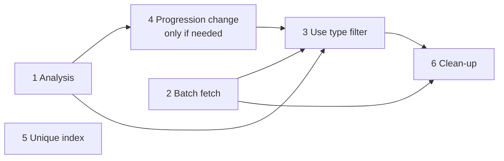

# Tickets: Create IDPC ingestion tasks only when an IDPC is available (Part 1)

> **Stage 3 — User Story** · Service: `cp-case-document-knowledge-service` (CDKS)
> **Spike:** [DD-43926](https://hmcts.atlassian.net/browse/DD-43926) (investigation & recommendation).
> **Design:** [`02-design.md`](./02-design.md) v2 (11-Nov-2026) · **ADRs:** [`../adrs/DD-43926-idpc-gated-ingestion-dispatch.md`](../adrs/DD-43926-idpc-gated-ingestion-dispatch.md)
> **Scope:** Part 1 only (filtered batch fetch). **Part 2 (Service Bus events) is deferred** – no ticket now.
> **Parent:** [DD-43976](https://hmcts.atlassian.net/browse/DD-43976). Sub-tickets raised: [DD-43977](https://hmcts.atlassian.net/browse/DD-43977) (analysis), [DD-43978](https://hmcts.atlassian.net/browse/DD-43978) (batch fetch).
> Tickets 3–6 are **not raised yet**: they will be created after the analysis ([DD-43977](https://hmcts.atlassian.net/browse/DD-43977)) concludes.

## Ticket map

| # | Jira | Ticket | Type | Owner | Depends on | Can start |
|---|---|---|---|---|---|---|
| P | [DD-43976](https://hmcts.atlassian.net/browse/DD-43976) | IDPC-gated ingestion – design & implementation (Part 1) | Parent (Story/Epic) | CDKS | Spike DD-43926 | – |
| 1 | [DD-43977](https://hmcts.atlassian.net/browse/DD-43977) | Analysis: can Progression's `sectionId` filter be used? Plus baseline measurement | Spike / Analysis | CDKS (+ Progression) | – | **Now** |
| 2 | [DD-43978](https://hmcts.atlassian.net/browse/DD-43978) | Batch document fetch (`FETCH_DOCUMENTS_BATCH`) – without type filter | Story | CDKS | – | **Now** |
| 3 | not raised yet | Use Progression's type filter in the batch fetch | Story | CDKS | 1, 4 | After 1 and 4 |
| 4 | not raised yet | Progression: type filter for batched court-document search | Story (Progression board) | Progression | 1 | After 1 (only if needed) |
| 5 | not raised yet | Unique index on `case_documents` | Story | CDKS | – | Now (independent) |
| 6 | not raised yet | Clean-up: remove CHECK task, CDKS type check, old toggles | Story | CDKS | 2, 3 live in production | Last |

---

## P — Parent: IDPC-gated ingestion – design & implementation (Part 1)

**Jira:** [DD-43976](https://hmcts.atlassian.net/browse/DD-43976)

**Title:** [CDKS] Create IDPC ingestion tasks only when an IDPC is available – batched, type-filtered fetch (Part 1)

**Type:** Story (parent) / Epic · **Links:** "is implemented by" spike DD-43926

**User story**
**As** the CDKS service owner
**I want** discovery to fetch documents for many listed cases in one Progression call, and create ingestion tasks only when a new IDPC is found
**So that** CDKS stops creating one check task and one Progression call for every listed case, and the ingestion flow is simpler to run and support

**Background**
Today, intraday (`GET_CASES_FOR_HEARING`) and nightly (`DiscoveryService`) discovery create one
`CHECK_IDPC_AVAILABILITY_ALL_DEFENDANTS` task per listed case. Each task calls Progression, gets every
document type, and CDKS keeps only the IDPC. For 5,000 listed cases this is 5,000 jobs and 5,000
calls, and many of them find nothing. Spike DD-43926 recommends a batched, type-filtered fetch
(design §6–7, ADR-001).

**Outcome**
- One fetch job per batch of 50 cases instead of one CHECK job per case (about 50 times fewer jobs and calls).
- Calls sent at a planned rate, with retries per batch.
- Progression returns IDPC documents only (once the type filter is live).
- `RETRIEVE_MATERIAL_AND_UPLOAD` created only for a new IDPC.

**Sub-tickets:** 1 Analysis (DD-43977) · 2 Batch fetch (DD-43978) · 3 Use type filter · 4 Progression change (linked, Progression board) · 5 Unique index · 6 Clean-up

**Done when**
- Sub-tickets 1, 2, 3, 5 and 6 are done, and 4 is done or recorded as not needed.
- Part 1 has run in production for at least one release with no missed IDPC (rollout step 1 in design §9.3).
- The toggle inventory (DD-43875) and the design/ADR files reflect the final state.

**Out of scope:** Part 2 (Service Bus events, `document_availability` table) – deferred.

---

## 1 — Analysis: can Progression's existing `sectionId` filter be used? (+ baseline)

**Jira:** [DD-43977](https://hmcts.atlassian.net/browse/DD-43977)

**Title:** [CDKS] Analysis – Progression `sectionId` filter vs new `documentTypeId` filter for batched IDPC fetch, and CHECK-task baseline

**Type:** Spike / Analysis · **Timebox:** 2–3 days · **Parent:** DD-43976

**Context**
For the batch response to contain only IDPC documents, Progression must filter by document type.
Design v2 proposes a new optional `documentTypeId` parameter on `courtdocumentsearch`
(`courtdocuments+json`). Progression already filters by type in SQL through `sectionId`, but only on
the paginated media type `courtdocuments.with.pagination+json`. Before asking Progression for a change,
confirm whether the existing filter can be used, as is or with a small change.

An initial reading of Progression `main` (`f3dbf8c`, 07-Nov-2026) is in design §6.0: `with.pagination`
filters by type and allows the system user, but appears to take one case only, return no case or
defendant per document, return only the first material, keep PDF only, and page results (20 by
default). These points must be confirmed.

**Questions to answer**
1. Can `with.pagination` take more than one `caseId` per call? If not, how big is the change?
2. Does the response give CDKS everything it needs for the placeholder and the RETRIEVE job:
   `courtDocumentId`, `documentTypeId`, **case and defendant per document**, **all materials**
   (or at least the latest) with `id` and `uploadDateTime`, and the material name?
3. Which material does `findFirst()` return when an IDPC has several versions? Is it always the latest?
4. Can an IDPC be non-PDF? Would the PDF-only filter drop real IDPCs?
5. What page size is needed to get all IDPCs for one case in one call? Is there a maximum?
6. Are the permission checks the same as on `courtdocuments+json`, so CDKS sees exactly what it sees today?
7. For 5,000 listed cases: how many calls, and how much Progression work, for each option?
8. `sectionId` takes one type ID. Is that acceptable, given the design wants a generic filter?

**Baseline (design §9.3, step 0)**
Measure today's behaviour so the gain can be shown later: per day, per environment where discovery
runs (`ste` today), count the log lines `Created CHECK_IDPC_AVAILABILITY_ALL_DEFENDANTS` and
`Saved CaseDocument placeholder`. Counts only, no case data.

**Acceptance criteria**

AC1 – Each of the 8 questions is answered with Progression code references (file:line, commit SHA).

AC2 – A recommendation is made for one option, with trade-offs (calls for 5,000 cases, CDKS change,
Progression change, risks):
- (a) use `with.pagination` + `sectionId` as is;
- (b) a small change to `with.pagination`;
- (c) the new `documentTypeId` parameter on `courtdocuments+json` (design §6.1–6.7).

AC3 – For option (a) or (b), a synthetic request/response example shows that CDKS can build the
placeholder and RETRIEVE job data from it.

AC4 – The recommendation is agreed with the Progression team (named contact), and the owner of any
Progression change is recorded.

AC5 – The result is recorded in design §6.0 and ADR-002, and ticket 4 is written for the Progression
board, or closed as not needed.

AC6 – The baseline counts are recorded in the design (§12, baseline query).

**Out of scope:** any code change in CDKS or Progression.

---

## 2 — Batch document fetch (`FETCH_DOCUMENTS_BATCH`) – without type filter

**Jira:** [DD-43978](https://hmcts.atlassian.net/browse/DD-43978)

**Title:** [CDKS] Replace per-case IDPC check with batched document fetch (`FETCH_DOCUMENTS_BATCH`)

**Type:** Story · **Parent:** DD-43976 · **Depends on:** none (can start now)

**User story**
**As** the CDKS service owner
**I want** discovery to fetch documents for up to 50 listed cases in one Progression call, at a planned rate
**So that** CDKS creates far fewer jobs and Progression calls, and creates RETRIEVE tasks only for a new IDPC

**Context**
This story delivers the batching, rate control and "RETRIEVE only for a new IDPC" behaviour (design §7).
It uses the **same** Progression query and media type CDKS uses today, with a list of case IDs. It does
**not** send a type filter: the existing CDKS type check in `ProgressionDtoMapper` keeps only IDPC
documents (design §7.7). The type filter is added by ticket 3.

**Scope**
- New task `FETCH_DOCUMENTS_BATCH`. Job data: `requestId`, `cppuid`, `caseIds` (≤ N), `batchNumber`,
  `batchCount`. IDs only.
- Discovery (intraday `GET_CASES_FOR_HEARING` and nightly `DiscoveryService`): remove duplicate case
  IDs, order by nearest hearing date, split into batches of N, create one job per batch with start time
  `runStart + i × S`, where `S = 60 / max-calls-per-minute`. Priority: the nearest hearing in the batch.
- The task makes **one** `courtdocumentsearch?caseId=c1,…,cN` call on the existing APIM + Managed
  Identity client: IDs joined with `,` and **no spaces**, **no** `defendantId` (design E1, E2).
- The task groups results by **(caseId, defendantId)**, takes the latest material by `uploadDateTime`,
  and applies the existing `IdpcAvailabilityService` rules unchanged (small refactor so it accepts
  documents already fetched).
- The task creates one `RETRIEVE_MATERIAL_AND_UPLOAD` per new IDPC through
  `RetrieveMaterialAndUploadJobDataService`.
- New configuration, added to the toggle inventory (DD-43875):
  - `cdk.ingestion.document-batch-dispatch.enabled` – default **false**
  - `cdk.ingestion.document-batch.size` – default 50
  - `cdk.ingestion.document-batch.max-calls-per-minute`
  - retry list `document-batch-retry` (for example 30, 60, 120, 300 s)
- `CheckIdpcAvailabilityAllDefendantsTask` stays registered, so CHECK jobs queued before the toggle is
  switched on still run.

**Acceptance criteria**

AC1 – Batches replace per-case CHECK
Given batch dispatch is on, and discovery lists 120 unique cases, and N = 50
When discovery runs
Then 3 `FETCH_DOCUMENTS_BATCH` jobs are created, with 50, 50 and 20 case IDs
And no `CHECK_IDPC_AVAILABILITY_ALL_DEFENDANTS` job is created.

AC2 – Duplicates and order
Given the same case is listed in two rooms or hearings
When discovery builds the batches
Then the case appears in exactly one batch
And cases are ordered by nearest hearing date.

AC3 – Spaced start times
Given `max-calls-per-minute` = 10
When discovery creates the batch jobs
Then batch *i* has start time `runStart + i × 6 s`.

AC4 – One call per batch, correct parameters
Given a batch job runs
Then exactly one `courtdocumentsearch` call is made
And `caseId` is comma-joined with no spaces
And `defendantId` is not sent.

AC5 – RETRIEVE only for a new IDPC
Given the response has a new IDPC for case A, only non-IDPC documents for case B, and nothing for case C
When the batch job completes
Then a `WAITING_FOR_UPLOAD` placeholder and one RETRIEVE job are created for case A
And nothing is created or saved for cases B and C.

AC6 – Material already held is skipped
Given the latest IDPC material for a case and defendant is already in `case_documents`
When a later batch returns it again
Then no placeholder and no RETRIEVE job are created.

AC7 – Grouping by case and defendant
Given a batch response has IDPCs for several cases and defendants
Then the latest material is chosen per (caseId, defendantId)
And the latest-defendant flag is set exactly as `IdpcAvailabilityService` sets it today.

AC8 – Retry on 5xx or timeout
Given Progression returns 5xx or times out
Then the job is retried using `document-batch-retry`
(the task overrides `getRetryDurationsInSecs()` – without it the task manager does not retry).
Given the retries are used up
Then the case IDs are logged at ERROR (IDs only), the batch is split into two jobs of half the size
(design §7.5), and a batch of one case completes without splitting.

AC9 – 429 Too Many Requests
Given Progression/APIM returns 429
Then the job is moved to now + `Retry-After`, or the next retry step if the header is missing
And the number of throttle reschedules is capped through job data.

AC10 – Other 4xx
Given a 4xx other than 429
Then the job is not retried, and an ERROR is logged with the batch size and case IDs.

AC11 – Toggle off keeps today's behaviour
Given batch dispatch is off
Then discovery creates per-case CHECK tasks exactly as today, and existing tests pass unchanged.

AC12 – CHECK jobs already queued still complete
Given CHECK jobs were queued before the toggle was switched on
When they run
Then they complete as they do today.

AC13 – Logging
Each batch logs one JSON line with `requestId`, `batchNumber`, `batchCount`, `casesInBatch`,
`casesWithIdpc`, `retrievalTasksCreated`.
Each discovery run logs one line with `casesListed`, `casesAfterDedup`, `batchesCreated`, and a WARN
when `batchCount × S` is longer than the intraday interval.
No names, URNs or document content are logged.

AC14 – Quality gates
PMD and JaCoCo pass without lowering thresholds, and `gradle integration` is green.

**Tests**
- Unit: batching, removing duplicates, ordering, start times; URL building (no spaces, no
  `defendantId`); grouping by case and defendant; retry, split, 429 and 4xx paths.
- Integration (`src/integrationTest`, WireMock Progression stub, synthetic IDs only): a batch with
  cases with a new IDPC, non-IDPC only and no documents; 500 then 200 is retried; 429 with
  `Retry-After`; toggle off gives today's CHECK behaviour.

**Out of scope:** Progression type filter (ticket 3); removing the CHECK task or the CDKS type check
(ticket 6); unique index (ticket 5); Part 2.

---

## 3 — Use Progression's type filter in the batch fetch

**Jira:** not raised yet – to be created after DD-43977 concludes.

**Title:** [CDKS] Request IDPC-only documents from Progression in the batch fetch

**Type:** Story · **Parent:** P · **Depends on:** 1 (route chosen), 4 (Progression change deployed, if needed), 2

**User story**
**As** the CDKS service owner
**I want** the batch fetch to ask Progression for IDPC documents only
**So that** Progression no longer reads, transforms and returns every document type, and CDKS no longer has to drop them

**Scope**
- Add the type filter to the batch call, using the route chosen in ticket 1 (option a, b or c). The
  type ID comes from configuration (`41be14e8-9df5-4b08-80b0-1e670bc80a5b` today).
- New toggle `cdk.ingestion.progression.document-type-filter.enabled` – default **false** – switched
  on per environment only once Progression supports the filter there. Added to the toggle inventory.
- Manual "Process IDPC" (`/ingestions/start-by-case`) uses the same filter when the toggle is on.
- The existing CDKS type check stays in place until ticket 6 (it is harmless when the response holds
  IDPC only).

**Acceptance criteria**

AC1 – Given the filter toggle is on, when a batch job runs, then the Progression call includes the type
filter for the configured IDPC type ID.

AC2 – Given the filter toggle is off, then the call is exactly as in ticket 2 (no filter).

AC3 – Given the filter toggle is on, and the response holds only IDPC documents, then placeholders and
RETRIEVE jobs are the same as with the toggle off for the same data.

AC4 – Given the filter toggle is on, when manual "Process IDPC" runs, then its Progression call
includes the filter, and its response to the caller is unchanged.

AC5 – Given Progression returns 400 (for example, a bad type ID in configuration), then the job is not
retried and an ERROR is logged and alerted.

AC6 – PMD, JaCoCo and `gradle integration` pass.

**Tests:** WireMock stub matches on the filter parameter; toggle on and off; 400 path.

**Note:** if ticket 1 chooses option (a) or (b), the call may use a different media type and response
mapping. Update this ticket's scope and ACs when ticket 1 closes.

---

## 4 — Progression: type filter for batched court-document search (Progression board)

**Jira:** not raised yet – to be created after DD-43977 concludes.

**Raise only if ticket 1 recommends option (b) or (c).** Write the final text from ticket 1's result.
Draft for option (c), the current proposal (design §6.1–6.7):

**Title:** [Progression] Add optional, generic `documentTypeId` filter to `courtdocumentsearch` (`courtdocuments+json`)

**Type:** Story · **Team:** Progression · **Linked to:** CDKS parent P, ticket 1

**Context**
CDKS (case-document-knowledge-service) checks for new IDPCs across hearing lists. It calls
`courtdocumentsearch` with a comma-separated list of `caseId` values, and today receives every document
type, then keeps only IDPC. A type filter lets Progression read, transform and return only the
requested types.

**Change**
- New optional query parameter `documentTypeId`: one or more reference-data document type IDs, comma
  separated, values trimmed and validated as UUIDs (400 on a bad value).
- Applies to media type `application/vnd.progression.query.courtdocuments+json`.
- When absent: behaviour exactly as today.
- When present: in the case-ID branch, a new repository method filters in SQL using the existing
  `jsonb_extract_path_text(payload, 'documentTypeId')` expression (as in
  `CourtDocumentIndexCriteriaRepository`). Other branches apply the same list in memory.
- No change to access control, permission filtering or the response schema.
- In the same change: fix the response schema `required: ["documents"]` → `documentIndices` (design E7).

**Acceptance criteria**
AC1 – Without `documentTypeId`, responses are unchanged for every existing caller.
AC2 – With one type ID, only documents of that type are returned, for every case in the list.
AC3 – With several type IDs, documents of any of those types are returned.
AC4 – A bad type ID returns 400.
AC5 – Permission filtering still applies to every returned document.
AC6 – Unit tests in `CourtDocumentQueryViewTest` and one integration test (a case with an IDPC and another document type returns only the IDPC).
AC7 – Progression confirms the maximum supported number of `caseId` values for the system user.

---

## 5 — Unique index on `case_documents`

**Jira:** not raised yet – to be created after DD-43977 concludes.

**Title:** [CDKS] Prevent duplicate document placeholders – unique index on `case_documents (case_id, defendant_id, material_id)`

**Type:** Story · **Parent:** P · **Depends on:** none

**Context**
Two fetches of the same case at the same time (for example, overlapping intraday runs, or a batch
running while manual "Process IDPC" runs) can both save a placeholder for the same material. This risk
exists today (brief F8) and remains with batching (design §7.5).

**Scope**
- A new Flyway migration (next version number) adds a unique index on
  `case_documents (case_id, defendant_id, material_id)`. Reviewed through `migration-reviewer`.
- Before the migration, check each environment for existing duplicates (counts only) and agree how to
  resolve them.
- The placeholder save treats a unique-key conflict as "already held" and creates no RETRIEVE job.

**Acceptance criteria**
AC1 – The duplicate check is run in every environment and the counts are recorded; any duplicates are
resolved before the migration is deployed there.
AC2 – Given two saves for the same (case, defendant, material) at the same time, then exactly one row
and one RETRIEVE job result, and no error reaches the task.
AC3 – The migration is append-only (no shipped `V*.sql` edited) and approved through `migration-reviewer`.
AC4 – `gradle integration` passes.

---

## 6 — Clean-up: remove the CHECK task, the CDKS type check and old toggles

**Jira:** not raised yet – to be created after DD-43977 concludes.

**Title:** [CDKS] Remove `CHECK_IDPC_AVAILABILITY_ALL_DEFENDANTS`, the CDKS IDPC type check and the Part 1 rollout toggles

**Type:** Story · **Parent:** P
**Depends on:** ticket 2 on in production for at least one release with no rollback; ticket 3 on in every environment

**Acceptance criteria**
AC1 – Given no CHECK jobs are queued or in progress in production (confirmed by a count on the job
table), when this change is deployed, then `CheckIdpcAvailabilityAllDefendantsTask`,
`TaskNames.CHECK_IDPC_AVAILABILITY_ALL_DEFENDANTS` and
`JobManagerService.dispatchCaseDocumentIngestionTasksCheckIdpcAvailability` are removed.

AC2 – The IDPC type check in `ProgressionDtoMapper.mapToLatestMaterialInfo` is removed (Progression now
returns IDPC only).

AC3 – `cdk.ingestion.document-batch-dispatch.enabled` and
`cdk.ingestion.progression.document-type-filter.enabled` are removed; the batch, filtered path is the
only path. The toggle inventory (DD-43875) is updated.

AC4 – References to the CHECK task in `.claude/context/cdks-context.md` and the DD-43182 retry table
are updated. `NightlyDiscoverySchedulerLiveTest` asserts the batch path. Historical pipeline docs are
left as they are.

AC5 – PMD, JaCoCo and `gradle integration` pass without lowering thresholds.

---

## Open questions (settle before Stage 4)

| ID | Question | Proposed answer | Who |
|---|---|---|---|
| OQ-1 | **Start time and priority of RETRIEVE tasks.** Batch jobs are spaced for Progression/APIM. Each batch can create up to 50 RETRIEVE tasks at once, which then reach RAG together. Today the nightly per-case stagger (DD-43823 A1) paces RAG load. The SIT RAG 500s on 11-Nov-2026 show RAG struggles with bursts. Design §7.3 does not say how RETRIEVE tasks are timed. | Each RETRIEVE task keeps its case's planned stagger start time and priority (as in the earlier draft's AC-5), so RAG pacing is unchanged. Decide in ticket 2 refinement. | CDKS team, service owner |
| OQ-2 | Values for batch size N and `max-calls-per-minute` | From the APIM asks (design §10: URL length, rate limit, `Retry-After`); confirm in NFT | APIM, CDKS |
| OQ-3 | One IDPC document for several defendants: today's mapper takes only the first defendant | Keep today's behaviour in ticket 2; raise a separate story if the service owner wants all defendants | Service owner |
| OQ-4 | Do dashboards or alerts key on the CHECK task name? | Checked 30-Oct-2026: `support/dashboard-kql/*.kql` does not; only `NightlyDiscoverySchedulerLiveTest` does (ticket 6) | – |
